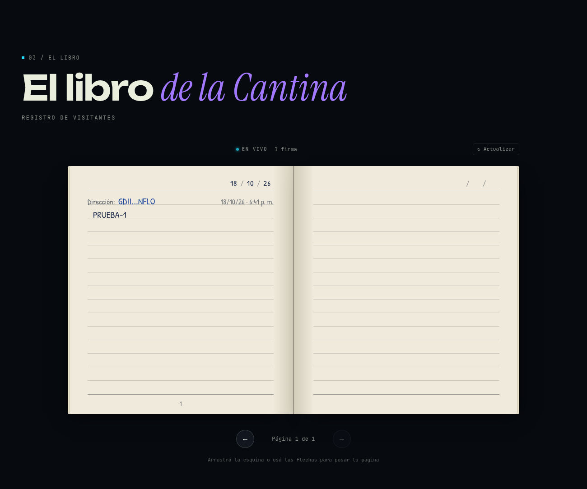
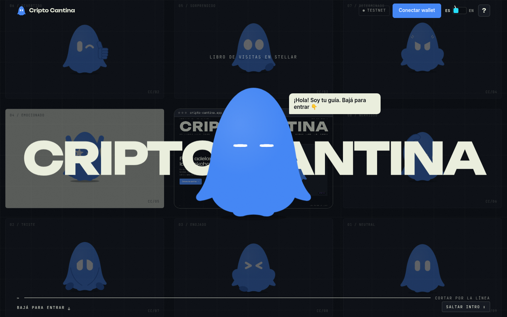
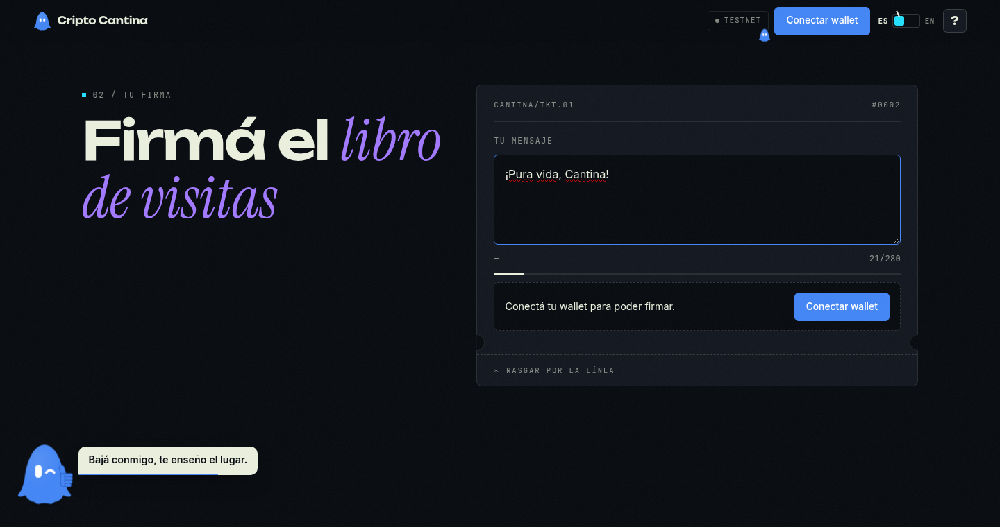
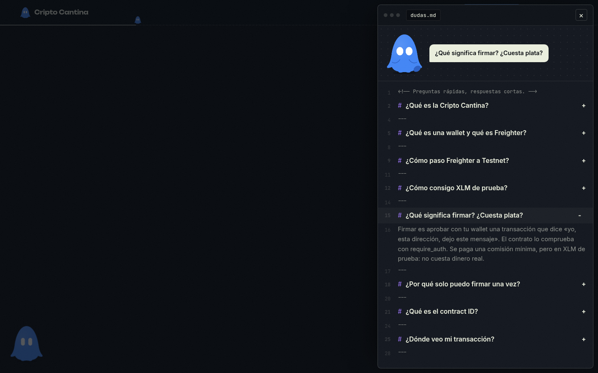

# Cripto Cantina · El libro de visitas

dApp en **Stellar Testnet** donde cualquiera conecta su wallet (Freighter), deja un mensaje firmado on-chain y lo ve escrito en *El libro de la Cantina*.

Entrega del **Stellar Challenge #1: «El libro de visitas de la Cripto Cantina»**.



| Intro | Firmar | Preguntas frecuentes |
| --- | --- | --- |
|  |  |  |

**Demo en vivo:** (próximamente)

## Contrato en Testnet

| | |
| --- | --- |
| **Contract ID** | `CCPGEQF44OMJGJWF7RV7PZA2XKUD2GCVH75A62FYHCBEKHL46UZQ5E3V` |
| **Explorador** | [Ver en stellar.expert](https://stellar.expert/explorer/testnet/contract/CCPGEQF44OMJGJWF7RV7PZA2XKUD2GCVH75A62FYHCBEKHL46UZQ5E3V) |
| **Red** | Stellar Testnet |

## Requisitos del reto

| Requisito | Dónde está |
| --- | --- |
| Proyecto creado con Scaffold Stellar | Generado con `stellar scaffold init`; configuración en [`scaffold.yml`](scaffold.yml) |
| Contrato propio con `firmar(autor, mensaje)` y `listar()` | [`contracts/guestbook/src/lib.rs`](contracts/guestbook/src/lib.rs) |
| Usa `require_auth` | `autor.require_auth()` al inicio de `firmar` |
| Frontend con el cliente generado | `app/` importa `guestbook` desde `@stellar-scaffold/app-lib/clients` (generado por `stellar scaffold build --build-clients`) |
| Conexión de wallet | Stellar Wallets Kit + Freighter (`app-lib/wallet.ts`) |
| Desplegado en testnet | Contract ID de arriba, registrado en `scaffold.yml` |
| README con contract ID, cómo correrlo y captura | Este archivo |

### Puntos extra

- **Una firma por dirección:** si la misma dirección intenta firmar otra vez, el contrato devuelve el error `YaFirmo`.
- **Eventos:** cada firma emite el evento `Firmado` (topic: `autor`, dato: `mensaje`), y la lista de la página lo escucha para actualizarse en vivo.
- **Tests:** 5 tests del contrato en [`contracts/guestbook/src/test.rs`](contracts/guestbook/src/test.rs).
- **Validaciones:** mensaje de 1 a 280 bytes; el almacenamiento extiende su TTL en cada firma.
- **Lo creativo:**
  - Intro inmersiva: la cámara entra en una pantalla y la página arranca adentro.
  - Mascota guía con 8 expresiones y tips rápidos en cada paso.
  - Panel **?** de preguntas frecuentes que explica la mascota.
  - Palanca **ES / EN**.
  - *El libro de la Cantina*: las firmas se muestran en un libro digital con páginas que se pasan y letra a mano.

## API del contrato

| Función | Descripción |
| --- | --- |
| `firmar(autor: Address, mensaje: String) -> Result<u32, Error>` | Exige `autor.require_auth()`, valida el mensaje, guarda la firma con la fecha del ledger, emite `Firmado` y devuelve el total de firmas. |
| `listar() -> Vec<Firma>` | Devuelve todas las firmas: `{ autor, mensaje, fecha }` (`fecha` = timestamp del ledger). |

| Código | Error | Cuándo |
| --- | --- | --- |
| 1 | `YaFirmo` | La dirección ya firmó el libro |
| 2 | `MensajeVacio` | El mensaje está vacío |
| 3 | `MensajeMuyLargo` | El mensaje pasa de 280 bytes |

## Tecnologías

- [Scaffold Stellar](https://github.com/stellar-scaffold/cli) (Stellar CLI + plugin `stellar-scaffold`)
- Contrato en Rust con Soroban SDK 26.1
- Frontend en React + Vite + TypeScript
- Stellar Wallets Kit + Freighter

## Cómo correrlo

### Requisitos previos

- [Rust](https://www.rust-lang.org/tools/install) con el target `wasm32v1-none`. El proyecto fija Rust 1.93.0 en `rust-toolchain.toml`, y `rustup` lo instala solo.
- Node.js 22 o más nuevo, con npm.
- [Stellar CLI](https://developers.stellar.org/docs/tools/developer-tools/cli/install-cli) y el plugin de Scaffold: `cargo install --locked stellar-scaffold-cli`.
- La extensión [Freighter](https://www.freighter.app/) en **Testnet**, con XLM de prueba (Friendbot).

### Pasos

```bash
git clone <url-de-este-repo>
cd cripto-cantina
npm install
cp .env.example .env        # contiene STELLAR_NETWORK=testnet
```

Genera el cliente TypeScript del contrato que ya está en testnet:

```bash
# bash / macOS / Linux
STELLAR_NETWORK=testnet stellar scaffold build --build-clients
```

```powershell
# Windows PowerShell
$env:STELLAR_NETWORK="testnet"; stellar scaffold build --build-clients
```

Levanta la página:

```bash
npm run dev
```

Abre <http://localhost:5173>, conecta Freighter (en Testnet) y firma el libro.

> En Windows, el `package.json` raíz trae un `overrides` para una dependencia de la wallet de Trezor que, sin él, corre `yarn setup` y hace fallar `npm install` si no tienes yarn.

### Tests del contrato

```bash
cd contracts/guestbook
cargo test
```

### Desplegar tu propia copia (opcional)

No hace falta para correr la página, porque usa el contrato ya desplegado. Si quieres uno propio:

```bash
stellar contract build
stellar contract deploy --wasm target/wasm32v1-none/release/guestbook.wasm --source-account <tu-identidad> --network testnet
```

Después pon el nuevo ID en `contracts.guestbook.networks.testnet.source` de `scaffold.yml` y vuelve a generar el cliente.

## Estructura

```
contracts/guestbook/          contrato Soroban (lib.rs + test.rs)
app/src/components/cantina/   mascota, intro, guía, ayuda, formulario, libro…
app/src/i18n.ts               textos en español e inglés
app-lib/                      wallet, red y cliente generado (clients/ no se versiona)
scaffold.yml                  redes y contratos
docs/                         capturas
```

## Autor

**Jose Daniel M**
