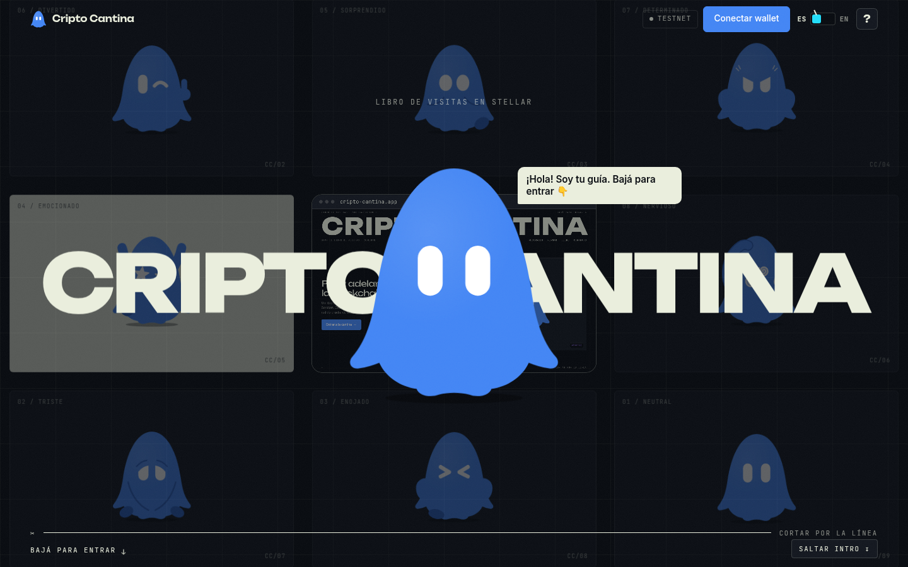

# El libro de visitas de la Cripto Cantina

Un libro de visitas **on-chain** en Stellar: conectás tu wallet (Freighter),
escribís un mensaje corto y lo firmás. El mensaje queda guardado en un contrato
inteligente de Soroban y cualquiera lo puede leer.

_A guestbook dApp on Stellar Testnet. The UI is bilingual (ES / EN)._



## Contrato en Testnet

| | |
| --- | --- |
| **Contract ID** | `CCPGEQF44OMJGJWF7RV7PZA2XKUD2GCVH75A62FYHCBEKHL46UZQ5E3V` |
| **Explorador** | [stellar.expert](https://stellar.expert/explorer/testnet/contract/CCPGEQF44OMJGJWF7RV7PZA2XKUD2GCVH75A62FYHCBEKHL46UZQ5E3V) |
| **Red** | Stellar Testnet |

Funciones (`contracts/guestbook`):

- `firmar(autor: Address, mensaje: String) -> Result<u32, Error>`: exige
  `autor.require_auth()`, valida el mensaje (1 a 280 bytes) y permite **una
  firma por dirección**. Emite el evento `firmado`.
- `listar() -> Vec<Firma>`: devuelve todas las firmas (`autor`, `mensaje`,
  `fecha` = timestamp del ledger).
- Errores: `YaFirmo = 1`, `MensajeVacio = 2`, `MensajeMuyLargo = 3`.

## La página

- Experiencia inmersiva de una sola página con estética mate (superficies
  planas, grano fino, líneas y grilla). Intro: el personaje y el título
  "Cripto Cantina" en primer plano y la cámara se mete en una pantalla que
  crece hasta llenar la vista; la página arranca adentro (botón "Saltar intro").
- Scroll suave con [Lenis](https://github.com/darkroomengineering/lenis) y un
  solo loop de `requestAnimationFrame` (solo `transform`/`opacity`); respeta
  "reducir movimiento" del sistema. Moneda 3D que se puede arrastrar.
- Un personaje guía (SVG animado, 8 expresiones) que da tips rápidos en cada
  paso y reacciona: se emociona al firmar, se pone nervioso con un error.
- Botón **?** con preguntas frecuentes explicadas por el personaje.
- Palanca **ES / EN** que cambia todo el texto (se recuerda en el navegador).
- Conexión con Freighter (Stellar Wallets Kit), aviso si la wallet está en otra
  red, botón para cargar XLM de prueba con Friendbot.
- Formulario con contador (280 bytes), estados claros (esperando aprobación,
  enviando, firmado con link a la transacción) y errores en lenguaje simple.
- Lista de firmas en vivo (escucha el evento `firmado`).

## Cómo correrlo

Requisitos: Rust + target `wasm32v1-none`, Stellar CLI, el plugin
`stellar-scaffold` y Node.js 22 o más nuevo.

```bash
cp .env.example .env      # STELLAR_NETWORK=testnet
npm install
npm run dev               # genera el cliente del contrato y levanta Vite
```

Abrí `http://localhost:5173`, conectá Freighter en **Testnet** y firmá.

Solo el build de producción:

```bash
STELLAR_NETWORK=testnet stellar scaffold build --build-clients
npm run build --workspace app
```

Tests del contrato:

```bash
cargo test -p guestbook
```

### Nota para Windows (`npm install`)

Una dependencia anidada de la wallet de Trezor (`@stellar/stellar-sdk@14.2.0`)
trae un `postinstall` con `yarn setup || true`, que falla en Windows si no
tenés `yarn`. El `package.json` raíz tiene un `overrides` que la cambia por la
`14.5.0`, que no tiene ese script, así que `npm install` funciona sin yarn.

## Estructura

```
contracts/guestbook/      contrato Soroban (lib.rs + test.rs)
app/src/i18n.ts           todos los textos en español e inglés
app/src/components/cantina/  personaje, guía, ayuda, formulario, lista…
app/src/styles/cantina.css   estilos y animaciones
app-lib/clients/          cliente TypeScript generado (no se versiona)
scaffold.yml              redes y contratos
```

Hecho con [Scaffold Stellar](https://github.com/stellar-scaffold/cli).
